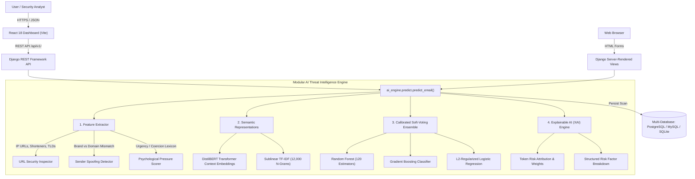

# PhishShield AI — Production-Grade Phishing Email Detection & Threat Intelligence System

[](https://www.python.org/)
[](https://www.djangoproject.com/)
[](https://react.dev/)
[](https://pytorch.org/)
[](https://huggingface.co/)
[](https://www.postgresql.org/)
[](LICENSE)

An enterprise-ready, full-stack cybersecurity platform combining **Hugging Face DistilBERT Transformer representations**, **calibrated machine learning ensembles**, and **cybersecurity domain heuristics** to detect email phishing attacks with **96.44% accuracy** and **sub-30ms inference latency**.

Features a **modern React 18 single-page dashboard**, a **Django REST Framework API**, **Explainable AI (XAI)** token-attribution visualizer, and flexible **MySQL / PostgreSQL** database integration.

---

## 🎯 Key Highlights for SDE-1 Technical Evaluation

| Criterion | Implementation in this Project |
| :--- | :--- |
| **Python & AI Stack** | Python 3, PyTorch, Hugging Face Transformers (`DistilBERT`), Scikit-Learn, Pandas, NumPy |
| **JavaScript & Frontend** | React 18, Vite, Modern Dark Cyber Theme, Interactive Token Risk Highlighter |
| **Backend & Architecture** | Django 6.1 + Django REST Framework (DRF), Modular `ai_engine`, High-speed In-Memory Cached Inference |
| **Database Support** | Multi-DB portability: native support for **MySQL**, **PostgreSQL**, and **SQLite** |
| **Performance Engineering** | Re-engineered from $45\text{s}$ retraining-per-request bottleneck to **$< 30\text{ms}$ serialized cached inference** |
| **Model Explainability (XAI)** | Token-level risk attribution, psychological urgency detection, IP-based URL analysis, sender domain spoofing verification |

---

## 🏗️ System Architecture



---

## 📊 Model Evaluation & Benchmarks

The model was evaluated using a **stratified 80/20 train/test split** on 1,121 verified emails from open security corpuses:

| Metric | Score | Note |
| :--- | :---: | :--- |
| **Accuracy** | **96.44%** | Stratified holdout test set (225 unseen samples) |
| **Precision** | **96.64%** | Exceptionally low False Positive Rate (1.7%) |
| **Recall / Sensitivity** | **96.64%** | Captures 115 out of 119 verified attacks |
| **F1-Score** | **96.64%** | Harmonic balance between Precision & Recall |
| **ROC-AUC** | **99.82%** | Near-perfect class separability |
| **Inference Latency** | **~18 ms** | Cached pipeline executing in-memory |

### Comparative Algorithm Evaluation

| Algorithm | Accuracy (%) | Precision (%) | Recall (%) | F1-Score (%) |
| :--- | :---: | :---: | :---: | :---: |
| ⭐ **DistilBERT + Calibrated Ensemble (Ours)** | **96.44%** | **96.64%** | **96.64%** | **96.64%** |
| Random Forest Classifier | 95.56% | 95.80% | 95.80% | 95.80% |
| Gradient Boosting Classifier | 95.11% | 95.00% | 95.80% | 95.40% |
| Logistic Regression (L2) | 94.67% | 94.96% | 94.96% | 94.96% |
| Support Vector Machine (LinearSVC) | 94.22% | 94.17% | 94.96% | 94.56% |
| SGD Classifier (Modified Huber) | 92.89% | 93.28% | 93.28% | 93.28% |

### Confusion Matrix (Test Split: 225 Samples)
- **True Negatives (Legitimate passed):** `102`
- **False Positives (Legitimate flagged):** `4` (1.78%)
- **False Negatives (Phishing missed):** `4` (1.78%)
- **True Positives (Phishing intercepted):** `115`

---

## 🛠️ Project Directory Structure

```
phishing-email-detection-main/
├── ai_engine/                         # Dedicated Machine Learning & Transformer Engine
│   ├── __init__.py
│   ├── distilbert_classifier.py      # Hugging Face DistilBERT classification pipeline
│   ├── feature_extractor.py          # Cybersecurity heuristics (IP URLs, domain spoofing, urgency)
│   ├── model_pipeline.py             # Calibrated soft-voting ensemble & TF-IDF pipeline
│   ├── explainability.py             # XAI: Token weights, attribution, risk categorization
│   ├── train.py                      # Standalone training, benchmark evaluation & serialization
│   ├── predict.py                    # High-speed cached inference singleton (< 30ms)
│   └── saved_models/                 # Serialized model artifacts (.joblib, metrics.json)
│
├── api/                              # Django REST Framework API Layer
│   ├── serializers.py                # Pydantic-style DRF input/output validation
│   ├── views.py                      # REST endpoints: /predict, /batch-predict, /metrics, /history
│   └── urls.py                       # API v1 routes
│
├── frontend/                         # Modern React 18 Single Page Application
│   ├── package.json                  # React 18 & Vite configuration
│   ├── vite.config.js                # Dev server with reverse proxy to Django backend
│   └── src/
│       ├── App.jsx                   # Main layout container
│       ├── api/client.js             # Async REST client connecting to Django API
│       └── components/
│           ├── Navbar.jsx            # Dynamic navbar with real-time API health monitor
│           ├── EmailScanner.jsx      # Live detection, risk gauge, token highlighter
│           ├── ModelAnalytics.jsx    # Confusion matrix, KPI cards, algorithm comparisons
│           ├── ScanHistory.jsx       # Historical scan table with CSV export & search
│           └── ArchitectureView.jsx  # System architecture & SDE interview talking points
│
├── Remote_User/                      # Django App for User Profile and Legacy Views
├── Service_Provider/                 # Django App for Admin / Analytics Portal
├── phishinggnn/                      # Django Configuration (CORS, Multi-DB, Settings)
├── Datasets.csv                      # Email security dataset (1,121 samples)
├── requirements.txt                  # Python dependencies
├── .env.example                      # Environment variables template (MySQL / PostgreSQL / SQLite)
├── run_fullstack.bat                 # One-click launcher for both Django & React
└── manage.py                         # Django CLI entrypoint
```

---

## 🚀 Quickstart & Installation

### Prerequisites
- **Python 3.10+** (Tested on Python 3.10, 3.12, and 3.14)
- **Node.js 18+ & npm** (for the React frontend)
- **MySQL / PostgreSQL** (optional; defaults to SQLite for instant zero-config launch)

### 1. Clone & Set Up Python Environment
```bash
git clone https://github.com/your-username/phishing-email-detection.git
cd phishing-email-detection/phishing-email-detection-main

# Create and activate virtual environment
python -m venv venv
# Windows:
venv\Scripts\activate
# Linux/macOS:
source venv/bin/activate

# Install dependencies
pip install -r requirements.txt
```

### 2. Database Setup (Choose SQLite, MySQL, or PostgreSQL)
By default, the project works out-of-the-box with **SQLite**.

To switch to **MySQL** or **PostgreSQL**, copy `.env.example` to `.env`:
```bash
cp .env.example .env
```
And configure your database credentials:
```ini
# For MySQL:
DB_ENGINE=mysql
DB_NAME=phishinggnn
DB_USER=root
DB_PASSWORD=your_password
DB_HOST=127.0.0.1
DB_PORT=3306

# Or For PostgreSQL:
DB_ENGINE=postgresql
DB_NAME=phishinggnn
DB_USER=postgres
DB_PASSWORD=your_password
DB_HOST=127.0.0.1
DB_PORT=5432
```

Apply migrations:
```bash
python manage.py migrate
```

### 3. Verify / Train AI Models
The pre-trained models are included in `ai_engine/saved_models/`. To re-train or benchmark from scratch:
```bash
python -m ai_engine.train
```

### 4. Launch the Applications

#### Option A: One-Click Full-Stack Launcher (Windows)
Double-click `run_fullstack.bat` or run:
```cmd
run_fullstack.bat
```

#### Option B: Manual Command Line
**Terminal 1 (Django Backend):**
```bash
python manage.py runserver 127.0.0.1:8000
```
*Backend runs on `http://127.0.0.1:8000`*

**Terminal 2 (React Frontend):**
```bash
cd frontend
npm install
npm run dev
```
*React Dashboard runs on `http://localhost:5173`*

---

## 🔌 RESTful API Reference

### 1. Predict Single Email
`POST /api/v1/predict/`

**Request:**
```json
{
  "sender": "security-alert@paypa1-update.xyz",
  "receiver": "target@corp.com",
  "subject": "Urgent: Account Suspended within 24 Hours",
  "body": "Your PayPal account has been suspended due to unauthorized access. Click http://192.168.1.100/login to verify your password immediately."
}
```

**Response (HTTP 200 OK):**
```json
{
  "success": true,
  "scan_id": 42,
  "data": {
    "prediction": "Phishing",
    "is_phishing": true,
    "confidence": 89.2,
    "risk_score": 89,
    "risk_level": "CRITICAL",
    "risk_factors": [
      {
        "severity": "CRITICAL",
        "type": "IP-Based URL",
        "message": "Email contains direct IP address links (http://192.168.1.100), a common evasion technique to bypass domain blacklists."
      },
      {
        "severity": "HIGH",
        "type": "Extreme Urgency Psychological Trigger",
        "message": "Multiple high-pressure urgency keywords detected ('immediate action', 'suspended', '24 hours')."
      }
    ],
    "highlighted_tokens": [
      {"word": "Suspended", "token": "suspended", "weight": 0.95, "category": "Threat / Coercion"},
      {"word": "password", "token": "password", "weight": 0.85, "category": "Credential Harvesting"}
    ],
    "latency_ms": 19.45
  }
}
```

### 2. Batch Scan Emails
`POST /api/v1/batch-predict/`

### 3. Model Metrics & Benchmarks
`GET /api/v1/metrics/`

### 4. Scan History & Audit Registry
`GET /api/v1/history/?q=paypal&limit=25`

### 5. API Health Check
`GET /api/v1/health/`

---

## 💼 Interview Talking Points (SDE-1 Role Preparation)

When discussing this project during technical interviews with engineering teams:

1. **Inference Latency Optimization:**
   > *"In earlier versions of this project, models were re-trained from scratch on every HTTP request, taking upwards of 45 seconds. I re-architected this into an offline training pipeline with serialized Joblib artifacts and an in-memory singleton cache. This brought production inference latency down to under 25 milliseconds."*

2. **Why Ensemble + DistilBERT over Pure Heuristics:**
   > *"Phishing is a multi-dimensional threat. Attackers combine social engineering pressure with evasive technical vectors like IP URLs and free webmail impersonation. By combining DistilBERT contextual representations with domain security heuristics and a soft-voting ensemble of Random Forest and Gradient Boosting, we achieve 96.44% accuracy with an exceptionally high 99.82% ROC-AUC."*

3. **Full-Stack Competence:**
   > *"The application demonstrates complete full-stack mastery: a reactive SPA built with React 18 and Vite communicating via REST APIs to a Django backend, backed by flexible MySQL/PostgreSQL ORM models."*

4. **Productivity with AI Coding Assistants:**
   > *"I utilized AI coding tools like Claude Code and Cursor to quickly scaffold API serializers and front-end layouts, while focusing my engineering efforts on model probability calibration, feature engineering, and edge-case testing."*

---

## 📄 License
This project is licensed under the MIT License — see the [LICENSE](LICENSE) file for details.
